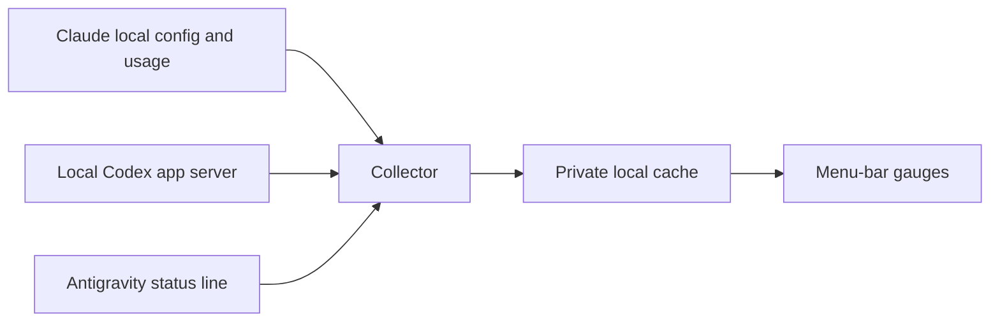

# Usage Meter

```text
                 .-----------.
              .-'   5h   7d   '-.
            .'    .----. .----.  '.
           /     /  ||  V  ||  \   \
          ;     |   ||     ||   |   ;
          |      \  ||  o  ||  /    |
          |       '----| |----'     |
          ;          __| |__        ;
           \       .'       '.     /
            '.    |  usage  |   .'
              '-._'---------'_.-'
                local gauges for local CLI limits
```

Usage Meter is a native macOS menu-bar app that shows the quota windows reported by Claude Code, Codex, and Antigravity (`agy`). It makes the active short and longer windows readable at a glance, then shows each reported limit, reset time, source, and data age in the dropdown.

It reads locally available state and each CLI's own supported local interface. It does not make model requests, alter CLI configuration, or send account data anywhere except the usage endpoint Claude Code already uses when it refreshes usage.

<p align="center">
  
</p>

The image above is rendered from fixed example percentages using the app's exact menu-bar geometry. It contains no account data.



## Features

- Shows a compact short-window and longer-window gauge for each available CLI.
- Gives every limit a percentage, reset time, source, and freshness indicator in the dropdown.
- Marks stale readings and collector failures clearly instead of presenting old data as current.
- Supports multiple Claude Code identities and keeps usage history for the Claude section.
- Includes Codex through its local app server and Antigravity through its documented status-line integration.
- Runs as a small native AppKit app with no third-party runtime or network service.

## Install

Requirements: macOS 14 or later, Xcode Command Line Tools, and Claude Code signed in at least once.

```sh
xcode-select --install
git clone https://github.com/ayush5harma/usage-meter.git
cd usage-meter
bash install.sh
```

The installer builds `Usage Meter.app`, installs the collector in `~/.local/bin`, and creates a per-user launchd agent. No `sudo` is required. If `/Applications` is not writable for your account, install into your user Applications folder:

```sh
APP_DIR="$HOME/Applications" bash install.sh
```

To remove the app and its launch agent:

```sh
bash uninstall.sh
bash uninstall.sh --purge # also removes the local usage cache and history
```

## What it reads and stores

The app itself does not access the network or Keychain. Its collector reads Claude Code's local configuration and obtains the matching OAuth credential through macOS Keychain, then refreshes usage with the same endpoint used by Claude Code. Codex usage comes from the local Codex app server. Antigravity reports quota through its status-line payload.

The collector caches responses under `~/.cache/usage-meter` with private permissions. The cache can include an account email, quota values, reset times, and a small local history. It never stores an OAuth token. Requests are rate-limited, failures back off, and the UI states the age and source of any cached value.

Read the [technical reference](docs/reference.md) for identity selection, cache behavior, supported environment variables, and the collector JSON contract.

## Build and verify

```sh
APP_DIR=/tmp/usage-meter-preview bash build.sh --force
bash test/codex-fixtures/run-all.sh
bash test/agy-statusline/run-all.sh
swift test/contrast/contrast.swift
```

`build.sh` produces an ad-hoc signed application bundle and fetches no dependencies. The fixture checks run without live accounts. The contrast check verifies the app's drawn gauge colors.

## Documentation

- [Design notes](docs/design.md)
- [Accessibility and contrast](docs/contrast.md)
- [Technical reference](docs/reference.md)
- [Architecture](docs/ARCHITECTURE.md)
- [Contributing](CONTRIBUTING.md)
- [Security policy](SECURITY.md)

## Contributing

Issues and pull requests are welcome. Start with [CONTRIBUTING.md](CONTRIBUTING.md); it covers local checks, fixture-based development, and the project's privacy expectations.

## License

[MIT](LICENSE)
