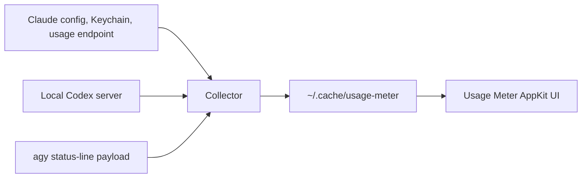

# Architecture

Usage Meter separates collection from presentation. A small local collector
normalizes available usage information, writes a private cache, and the AppKit
menu-bar app draws gauges from that cache.

## Trust boundaries

The app reads the local cache; it does not access the network or Keychain.
The collector may retrieve a Claude OAuth credential through macOS Keychain and
refresh usage using Claude's usage endpoint. Codex stays on its local app
server path, and agy contributes its documented status-line data.

The cache is private and can contain an account email, quota percentages,
reset times, sources, and a short history. It never stores OAuth tokens.
Freshness and source labels are part of the UI contract so cached data is not
presented as live data.

## File map

| Path | Responsibility |
| --- | --- |
| `bin/usage-meter-stats` | collector and normalized JSON contract |
| `Sources/main.swift` | AppKit menu-bar interface and gauges |
| `bin/agy-usage-statusline` | Antigravity status-line integration |
| `launchd/` | periodic per-user collector launch agent |
| `test/` | offline provider fixtures and rendering checks |

See [reference.md](reference.md) for identity selection, cache retention, and
environment variables.
